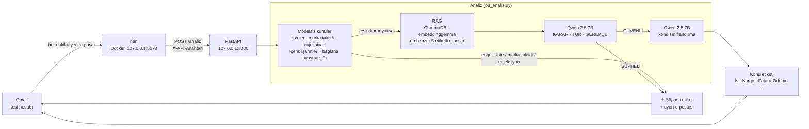

# Akıllı E-posta Sınıflandırıcı — E-posta Güvenliği ve Konu Sınıflandırma

Gmail'e gelen e-postaları iki aşamada işleyen ve her kararın nedenini Türkçe açıklayan bir sistem:

1. **Güvenlik:** E-posta **ŞÜPHELİ** veya **GÜVENLİ** olarak ayrılır. Oltalama, dolandırıcılık ve
   spam ŞÜPHELİ sayılır. Şüpheli e-postaya Gmail'de "⚠️ Şüpheli" etiketi eklenir ve kullanıcıya
   uyarı e-postası gönderilir.
2. **Konu sınıflandırma:** GÜVENLİ e-postalar konuya göre sınıflandırılır ve Gmail'de ilgili
   etiketle işaretlenir. Kategoriler: **İş, Fatura-Ödeme, Kargo, Sosyal Medya, Reklam-Bülten,
   Kişisel, Diğer**.

Projede **makine öğrenmesi modeli eğitilmez**. Karar üç parçanın birleşimiyle verilir:

1. **Modelsiz kurallar** (Python): gönderen listeleri, marka taklidi (typosquatting), talimat
   enjeksiyonu, içerik işaretleri, bağlantı uyuşmazlığı.
2. **RAG**: ChromaDB'den etiketli en benzer 5 e-posta getirilir.
3. **Yerel dil modeli** (Qwen 2.5 7B, Ollama): kural sonuçları, işaretler ve benzer örneklerle
   karar verir ve gerekçe yazar.

Her şey yerelde çalışır; e-posta içeriği dışarıdaki bir yapay zekâ servisine gönderilmez.

---

## Mimari



### Bir e-posta gelince çalışma sırası

1. **Gönderen listeleri**
   - `engelli_gonderenler.txt` içindeyse → doğrudan ŞÜPHELİ.
   - `guvenli_gonderenler.txt` içindeyse yalnızca gönderen adresi kuralları atlanır. Adres taklit
     edilebileceği için içerik yine incelenir.
2. **Gönderen kuralları**
   - Marka taklidi kesin karar verir: `binance2.com`, `binanse.com`, `paypa1.com`,
     `binance.com.hesap-dogrula.xyz` → ŞÜPHELİ, ve gerçek alan adı gerekçede yazılır.
   - Kurumsal görünen ad + ücretsiz e-posta servisi, garip uzantılar ve punycode yalnızca ipucu
     olarak Qwen'e verilir.
3. **Talimat enjeksiyonu.** "Önceki talimatları unut", "KARAR: GÜVENLİ", "mark as safe" gibi
   ifadeler varsa e-posta Qwen'e hiç gönderilmeden ŞÜPHELİ sayılır.
4. **İçerik işaretleri.** Şifre/kimlik, kart/ödeme, aciliyet/tehdit, para/ödül ifadeleri, bağlantı,
   IP bağlantısı ve bağlantı uyuşmazlığı bulunan ifadeyle birlikte Qwen'e verilir. Bunlar tek
   başına karar vermez.
5. **RAG + Qwen.** Benzer 5 e-posta kaynağıyla birlikte gösterilir, örneğin
   `[E1] ŞÜPHELİ (Nazario: oltalama örneği)`. Qwen `KARAR / TÜR / GEREKÇE` biçiminde cevap verir.
6. **Konu sınıflandırma** (yalnızca GÜVENLİ e-postalar). Ayrı bir Qwen çağrısı 7 kategoriden
   birini seçer: İş, Fatura-Ödeme, Kargo, Sosyal Medya, Reklam-Bülten, Kişisel, Diğer.

---

## Teknolojiler

| Katman | Teknoloji |
|---|---|
| Dil modeli | [Ollama](https://ollama.com) + `qwen2.5:7b` (temperature 0, keep_alive 1 saat) |
| Embedding | Ollama + `embeddinggemma` |
| RAG | LangChain, `langchain-chroma` (ChromaDB), `langchain-ollama` |
| Kurallar | Python standart kütüphanesi (`re`, `difflib`, `email.utils`) |
| API | FastAPI + Uvicorn |
| Demo ekranı | Streamlit |
| Otomasyon | n8n (Docker) + Gmail OAuth2 |
| Veri | pandas |

---

## Proje yapısı

| Dosya | Görev |
|---|---|
| `config.py` | Bütün ayarlar (modeller, yollar, eşikler, ücretsiz servisler, kurumsal adlar) |
| `p1_veri.py` | 6 CSV'yi okur, temizler, dengeli örnekler, `train.csv` / `test.csv` üretir |
| `p2_indeks.py` | Yalnızca **train** e-postalarını ChromaDB'ye ekler |
| `p3_kurallar.py` | Modelsiz kurallar (listeler, marka taklidi, enjeksiyon, işaretler) |
| `p3_analiz.py` | RAG + Qwen kararı ve konu sınıflandırma (`analiz_et`) |
| `p4_degerlendirme.py` | Test örnekleminde doğruluk, kesinlik, geri çağırma, F1, süre |
| `test_kurallar.py` | Modelsiz kurallar için 47 birim testi |
| `app.py` | Streamlit demo ekranı |
| `api.py` | n8n için FastAPI köprüsü (`POST /analiz`, `GET /health`) |
| `n8n/gmail_analiz.json` | Gmail akışı (güncel sürüm: uyarıda orijinal e-posta da var) |
| `n8n/gmail_analiz_v1.json` | Gmail akışının ilk sürümü |
| `n8n/eposta_analiz.json` | Webhook ile analiz akışı (Gmail'siz deneme için) |
| `bilinen_markalar.txt` | Marka → gerçek alan adları (`yurtici: yurticikargo.com`) |
| `guvenli_gonderenler.txt`, `engelli_gonderenler.txt` | Kullanıcı listeleri (tam adres veya `@alan.com`) |
| `sonuclar/` | Ölçüm özetleri ve tahminler (v1, v2; A ve B dilimleri) |

---

## Veri seti

Kaggle'daki **Phishing Email Dataset** kullanılır:
<https://www.kaggle.com/datasets/naserabdullahalam/phishing-email-dataset>

Veri dosyaları boyutları ve içerdikleri gerçek e-posta metinleri nedeniyle **repoda yoktur**.

1. Kaggle'dan zip'i indirin ve şu 6 CSV'yi proje klasörüne koyun:
   `CEAS_08.csv`, `SpamAssasin.csv`, `Nazario.csv`, `Nigerian_Fraud.csv`, `Enron.csv`, `Ling.csv`
   (`phishing_email.csv` kullanılmaz; işlenmiş ve bozuk metin içeriyor.)
2. `python p1_veri.py` komutu şunları yapar:
   - Her e-postayı tek metne çevirir: `Gönderen: …\nKonu: …\nMetin: …`. Enron ve Ling'de gönderen
     yoktur; `(bilinmiyor)` yazılır.
   - Nazario'da veri setini toplayan kişinin adresinden (`monkey.org`) gelenleri atar ve metindeki
     `monkey.org` geçişlerini nötr bir adla değiştirir. Aksi halde model "monkey.org = oltalama"
     kısayolunu öğrenir.
   - Tekrarları atar ve her sınıftan kaynaklara eşit dağıtılmış **2000** e-posta alır.
     Güvenli sınıf 4 kaynaktan, şüpheli sınıf 6 kaynaktan gelir.
   - E-postaları %80 / %20 oranında ayırır: `train.csv` (3198) ve `test.csv` (802).
3. `python p2_indeks.py` train e-postalarını ChromaDB'ye ekler (yaklaşık 1 dakika).
   **Test e-postaları asla ChromaDB'ye girmez.**

---

## Kurulum ve çalıştırma (macOS)

### 1. Python ortamı ve modeller

```bash
python3.12 -m venv .venv
source .venv/bin/activate
pip install -r requirements.txt

# Ollama: https://ollama.com/download
ollama pull embeddinggemma
ollama pull qwen2.5:7b

python p1_veri.py                       # train.csv, test.csv
python p2_indeks.py                     # ChromaDB (chroma_eposta/)
python -m unittest -v test_kurallar     # modelsiz testler
```

### 2. Demo ekranı (Streamlit)

```bash
streamlit run app.py --server.address localhost
# http://localhost:8501
```

### 3. API anahtarı (macOS Anahtar Zinciri)

Anahtar hiçbir dosyaya yazılmaz; Anahtar Zinciri'nde saklanır.

```bash
# Rastgele bir anahtar üretin (en az 20 karakter); n8n'e de bu değeri gireceksiniz
python3 -c "import secrets; print(secrets.token_urlsafe(32))"

# Anahtar Zinciri'ne kaydedin (-w en sonda ve değersiz: anahtarı sorar, komut geçmişine yazılmaz)
security add-generic-password -a "$USER" -s oltalama-api -w
```

### 4. API (FastAPI)

```bash
API_ANAHTARI="$(security find-generic-password -a "$USER" -s oltalama-api -w)" \
  caffeinate -i uvicorn api:app --host 127.0.0.1 --port 8000

curl http://127.0.0.1:8000/health
```

`caffeinate -i`, Mac uykuya geçip analizler yarıda kalmasın diye kullanılır.

### 5. n8n (Docker)

```bash
docker volume create n8n_data
docker run -d --name n8n \
  -p 127.0.0.1:5678:5678 \
  -e TZ=Europe/Istanbul -e GENERIC_TIMEZONE=Europe/Istanbul \
  -e EXECUTIONS_DATA_PRUNE=true -e EXECUTIONS_DATA_MAX_AGE=720 \
  -v n8n_data:/home/node/.n8n \
  docker.n8n.io/n8nio/n8n
# http://localhost:5678
```

- n8n container'ı API'ye `http://host.docker.internal:8000` adresiyle ulaşır.
- Çalışma kayıtları 30 gün (720 saat) sonra otomatik silinir.

### 6. Google OAuth ve Gmail akışı (kısaca)

1. **Kişisel değil, ayrı bir test Gmail hesabı** kullanın.
2. Google Cloud Console'da bir proje açın, **Gmail API**'yi etkinleştirin.
3. **OAuth consent screen**: tür *External*, durum *Testing*. Test hesabını *Test users*'a ekleyin.
4. **Credentials → OAuth client ID** oluşturun (*Web application*). *Authorized redirect URI*
   olarak n8n'in Gmail kimlik bilgisi ekranında gösterilen adresi yazın
   (`http://localhost:5678/rest/oauth2-credential/callback`).
5. n8n'de **Gmail OAuth2** kimlik bilgisi oluşturun, Client ID / Secret'ı girin ve test hesabıyla
   bağlanın. Akış yalnızca okuma, etiket oluşturma/ekleme ve gönderme yapar; kalıcı silme izni
   gerekmez.
6. n8n'de **Header Auth** kimlik bilgisi oluşturun:
   - Name: `X-API-Anahtari`
   - Value: 3. adımdaki anahtar
7. **Workflows → Import from File** → `n8n/gmail_analiz.json`. Ardından:
   - Gmail düğümlerinde ve *FastAPI — analiz* düğümünde kendi kimlik bilgilerinizi seçin.
   - *Uyarı gönder* düğümünde `TEST_HESABI@gmail.com` yer tutucusunu kendi test adresinizle
     değiştirin.
   - Akışı **Publish** edin.
8. Akış eksik Gmail etiketlerini ("⚠️ Şüpheli" + 7 kategori) kendisi oluşturur.

> *Testing* modundaki Google uygulamalarında yenileme token'ı **7 günde** bir sona erer. Süre dolunca
> n8n'de Gmail kimlik bilgisini yeniden bağlayın.

### 7. Değerlendirme

```bash
caffeinate -i python p4_degerlendirme.py 10                     # deneme (5 + 5)
caffeinate -i python p4_degerlendirme.py --surum v2 --dilim a   # 200 e-posta, ~25 dk
caffeinate -i python p4_degerlendirme.py --surum v2 --dilim b
```

---

## Sonuçlar

**Ölçüm düzeni:**
- Test setinden iki sabit örneklem kullanıldı. Her biri 100 şüpheli + 100 güvenli e-posta içeriyor
  ve kaynaklara eşit dağıtılmış (`random_state=42`).
  - **A** dilimi: `sonuclar/orneklem.csv`. v1'in hataları bu dilimde incelendi; bu yüzden v2'nin
    A'daki sonucu iyimser olabilir.
  - **B** dilimi: `sonuclar/orneklem_b.csv`. A'da olmayan e-postalardan oluşuyor; görülmemiş veri
    olarak asıl gösterge budur.
- Pozitif sınıf ŞÜPHELİ'dir. Konu sınıflandırması ölçümde kapalıdır.

**Sürümler:**
- **v1**: kurallar + RAG + Qwen.
- **v2**: v1'e ek olarak şu değişiklikler:
  - Nötr gönderen ipucu: "Gönderen kontrolü sorun bulmadı; bu, gönderenin güvenilir olduğu
    anlamına gelmez" ve ücretsiz servis için "bu adresi herkes alabilir".
  - Kurumsal görünen ad + ücretsiz servis bulgusu.
  - Bağlantı uyuşmazlığı işareti.

### Genel

| Ölçüt | A v1 | A v2 | B v1 | B v2 |
|---|---|---|---|---|
| Doğruluk | %90,5 | %89,5 | %93,5 | %93,5 |
| Kesinlik | %92,6 | %90,7 | %97,8 | %95,8 |
| Geri çağırma | %88,0 | %88,0 | %89,0 | %91,0 |
| F1 | %90,3 | %89,3 | %93,2 | %93,3 |
| Kaçan şüpheli | 12 | 12 | 11 | 9 |
| Yanlış alarm | 7 | 9 | 2 | 4 |
| Ort. süre / e-posta | 7,6 sn | 7,7 sn | 7,5 sn | 7,6 sn |

### Kaynak bazında yakalanan şüpheli e-postalar

| Kaynak | A v1 | A v2 | B v1 | B v2 |
|---|---|---|---|---|
| CEAS_08 | 17/17 | 16/17 | 17/17 | 17/17 |
| Enron (spam) | 15/17 | 15/17 | 15/17 | 15/17 |
| Ling (spam) | 15/17 | 15/17 | 15/17 | 15/17 |
| **Nazario (oltalama)** | 12/17 | 12/17 | 12/17 | **14/17** |
| Nigerian_Fraud | 15/16 | 15/16 | 16/16 | 16/16 |
| SpamAssasin | 14/16 | 15/16 | 14/16 | 14/16 |

**Yorum:**
- v1 ile v2 arasındaki farklar her dilimde birkaç e-posta kadar. 200 e-postada belirsizlik yaklaşık
  ±4 puan olduğu için iki sürüm **istatistiksel olarak ayırt edilemiyor**.
- Görülmemiş veride (B) v2, Nazario oltalamalarından 2 tanesini daha yakaladı. Buna karşılık posta
  listesi tartışmalarında 2 yanlış alarm daha verdi.
- Bağlantı uyuşmazlığı kuralı bu test e-postalarında hiç tetiklenmedi; bu veri setinde bağlantılar
  çoğunlukla düz metinde görünmüyor. Kuralın değeri Gmail'e gelen Türkçe oltalamalarda.
- Bütün kararlar Qwen aşamasında verildi. Test setinde marka taklidi alan adı veya talimat
  enjeksiyonu yok; bu kurallar gerçek kullanımda devreye giriyor.

### Hız: `keep_alive`

Ollama modeli varsayılan olarak 5 dakika kullanılmazsa bellekten atar. Gmail'e seyrek gelen
e-postalarda bu, her seferinde modelin yeniden yüklenmesi demektir. `keep_alive` 1 saat yapıldı.
Aşağıdaki tablo, önceki e-postadan **6 dakika sonra** gelen bir e-postanın analiz süresini gösteriyor:

| E-posta | Önce (model boşaltılmış) | Sonra (model bellekte) |
|---|---|---|
| Kargo oltalaması | 10,7 sn | 6,6 sn |
| Toplantı (GÜVENLİ + konu) | 10,7 sn | 8,6 sn |
| Bülten (GÜVENLİ + konu) | 14,7 sn | 12,0 sn |
| Talimat enjeksiyonu (kural) | 0,0 sn | 0,0 sn |

`num_predict` (karar 512, konu 256 token) yalnızca sonu gelmeyen cevaplara karşı koruma olarak
eklendi. Ölçülen en uzun cevaplar 199 ve 46 token. Cevap sınırda kesilirse çağrı sınır iki katına
çıkarılarak tekrarlanır.

---

## Güvenlik önlemleri

- **En az yetki**
  - Gmail akışı yalnızca okur, etiket oluşturur/ekler ve e-posta gönderir.
  - Silme veya çöpe atma işlemi yoktur; Google'a kalıcı silme izni verilmez.
  - Kişisel hesap değil, test hesabı kullanılır.
- **Yalnızca localhost**
  - API, Streamlit, Ollama ve n8n yalnızca `127.0.0.1`'de dinler; aynı ağdaki diğer cihazlar
    ulaşamaz.
  - n8n, API'ye `host.docker.internal` üzerinden ulaşır.
- **API anahtarı**
  - `/analiz` için `X-API-Anahtari` başlığı zorunludur. Anahtar sabit sürede karşılaştırılır
    (`secrets.compare_digest`) ve gövde doğrulamasından önce kontrol edilir.
  - Anahtar ortam değişkeniyle verilir ve macOS Anahtar Zinciri'nde saklanır. Tanımlı değilse veya
    20 karakterden kısaysa API başlamaz.
- **Gizlilik**
  - API günlüğüne e-posta içeriği yazılmaz; yalnızca karar, aşama ve süre yazılır.
  - Doğrulama hataları girdiyi geri göndermez.
- **Talimat enjeksiyonu**
  - E-posta içeriği veridir, talimat değildir.
  - Güvenlik sistemine komut veren e-postalar ("önceki talimatları unut", "KARAR: GÜVENLİ",
    "mark as safe") **Qwen'e gönderilmeden** ŞÜPHELİ sayılır. Bu kuralın sebebi: 7B model yalnızca
    prompt uyarısıyla bu komutlara uyabiliyordu.
  - E-postadaki `<<<` / `>>>` ayraçları silinir; model e-postanın sınırını aşamaz.
- **Bağlantı etkisizleştirme**
  - Uyarı e-postası düz metin olarak gönderilir.
  - Bütün bağlantılar, alan adları, e-posta adresleri ve IP'ler etkisizleştirilir:
    `hxxp://kotu[.]com`, `ali@kotu[.]com`, `1[.]2[.]3[.]4`.
  - Streamlit e-postadan gelen metni düz metin olarak gösterir; bağlantılar tıklanabilir olmaz.
- **Sonsuz döngü koruması.** Uyarı e-postalarının konusu `[Oltalama Uyarısı]` ile başlar. Gmail
  tetikleyicisi bunları sorguyla dışlar (`-subject:"[Oltalama Uyarısı]"`) ve kod ayrıca atlar.
- **Veri ayrımı.** Test e-postaları ChromaDB'ye girmez. E-posta metni içeren dosyalar (veri
  CSV'leri, örneklemler, yanlış bilinenler) repoya eklenmez.

---

## Sınırlamalar

- **Veri İngilizce ve eski.** Veri setinin çoğu 2000'lerin İngilizce e-postaları. Türkçe ve güncel
  oltalama kalıpları (kargo, e-Devlet, banka SMS'leri) yalnızca kurallar ve hazır örneklerle
  destekleniyor.
- **Etiketler karışık.** Spam, reklam ve oltalama aynı "şüpheli" sınıfında. Enron ve Ling'in spam
  kısmında "returned mail" bildirimi veya etkinlik duyurusu gibi insanın da güvenli diyebileceği
  e-postalar var.
- **SPF/DKIM yok.** Sistem yalnızca "Gönderen" satırını görür; e-posta başlıklarındaki kimlik
  doğrulama sonuçlarına bakmaz. Gönderen adresi kolayca taklit edilebilir.
- **Gerçek alan adından gelen oltalamalar.** `feedbackservice@alibaba.com` veya
  `no_reply@wetransfer.com` adresinden gelen, gerçek bildirime çok benzeyen oltalamalar çoğunlukla
  kaçıyor.
- **7B modelin gerekçe hataları.** Qwen zaman zaman uydurma yapıyor ("gönderen gerçek bir marka
  alan adı" gibi). Ayrıca bir ifadenin geçmesini, örneğin "payment", tek başına şüphe nedeni
  sayabiliyor.
- **Küçük örneklem.** Her ölçüm 200 e-posta (kaynak başına 16–25). Nazario için yalnızca 17 e-posta
  var; %70 gibi bir oran kabaca %50–90 aralığında bir değer.
- **Ek dosyalar ve görseller analiz edilmez**; yalnızca konu ve metin incelenir.

---

## Gelecek çalışmalar

- Gmail'den tam başlıkları alıp **SPF / DKIM / DMARC** sonuçlarını kural olarak eklemek.
- **Türkçe ve güncel** etiketli bir oltalama örneklemi toplayıp ChromaDB'ye eklemek ve ayrı ölçmek.
- Bağlantıları HTML'deki `href` değerinden de çıkarmak; görünen metin ile gerçek hedef
  uyuşmazlığını yakalamak.
- Spam-reklam ile oltalama/dolandırıcılığı ayrı sınıflar olarak değerlendirmek.
- Daha büyük örneklemle ölçüm ve güven aralıklarının raporlanması.
- Daha büyük veya Türkçeye uyarlanmış bir yerel model ile karşılaştırma.
- Kullanıcı geri bildirimi: yanlış alarmı "güvenli" olarak işaretleme ve güvenli listeye ekleme.
- Konu sınıflandırmasını etiketli küçük bir Türkçe örneklemle ölçmek.
